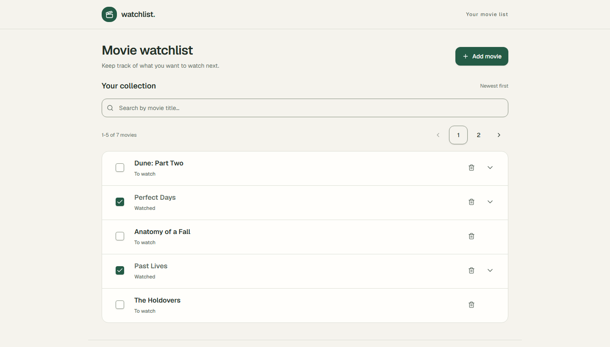
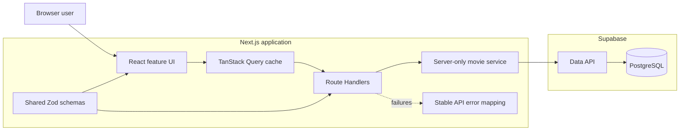
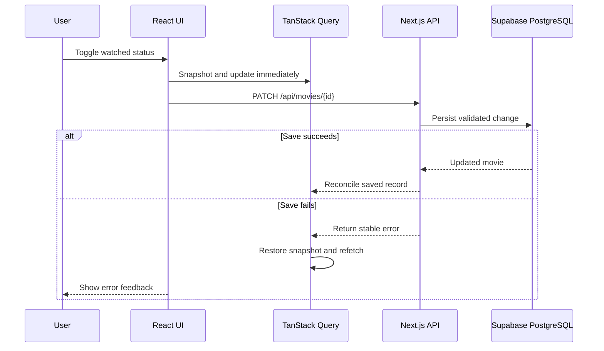

<!--suppress HtmlDeprecatedAttribute -->
<div align="center">


# Movie Watchlist

**A full-stack Next.js watchlist built around resilient optimistic updates, server-side validation, accessible interactions, Supabase persistence, and browser-level verification.**

[](https://github.com/adhambatlouni/movie-list/actions/workflows/ci.yml)
[](https://adham-movie-watchlist.vercel.app/)


[Live demo](#live-demo) · [Architecture](#architecture) · [Workflow](#product-workflow) · [Quick start](#quick-start) · [API](#api-reference) · [Testing](#testing-and-ci) · [Decisions](#engineering-decisions)

</div>

---

Movie Watchlist is a full-stack web application for saving films, attaching
notes, tracking watched status, and finding entries through server-side search
and pagination. The interface stays responsive during writes, preserves search
and page state in the URL, and stores every change in Supabase PostgreSQL.

The codebase separates interaction, HTTP, validation, and persistence concerns.
React components compose the experience, TanStack Query manages server state,
Next.js Route Handlers define the API boundary, shared Zod schemas protect both
forms and requests, and server-only services own database access.

<p align="center">
  <a href="https://adham-movie-watchlist.vercel.app/">
    
  </a>
  <br />
  <sub>Production interface shown with deterministic sample data.</sub>
</p>

## Live demo

The production application runs on Vercel with persistent data stored in
Supabase.

- **Application:** [Open Movie Watchlist](https://adham-movie-watchlist.vercel.app/)
- **Repository:** [View the source on GitHub](https://github.com/adhambatlouni/movie-list)

The demo uses one shared watchlist and intentionally has no user accounts.
Visitors can change the same disposable data, so do not add private information.

## Engineering at a glance

| Area | Implementation |
|---|---|
| **Product experience** | Add, search, paginate, expand notes, toggle watched status, and confirm deletion |
| **Client state** | TanStack Query with scoped cache keys, request cancellation, optimistic updates, rollback, and reconciliation |
| **URL state** | Debounced title search and page selection survive refresh and Back/Forward navigation |
| **API boundary** | Next.js Route Handlers with strict media-type handling and stable JSON errors |
| **Validation** | Shared Zod schemas normalize text, reject unknown fields, and validate UUID and query parameters |
| **Persistence** | Supabase PostgreSQL with deterministic ordering, an indexed migration, and server-only credentials |
| **Accessibility** | Semantic controls, focus restoration, keyboard workflows, reduced-motion support, and axe checks |
| **Verification** | Jest, React Testing Library, Playwright, live database checks, and live HTTP smoke tests |
| **Delivery** | Vercel deployment, multi-stage non-root Docker image, and GitHub Actions CI |

## Architecture



The browser never receives the Supabase secret. Client requests stop at the
Next.js API, where input is parsed before server-only services access Supabase.
Feature code stays under `features/movies`, while reusable interface and HTTP
utilities remain outside the feature boundary.

## Product workflow

1. Add a title and optional note through the validated dialog.
2. Search by title with a 300 ms debounce; `q` and `page` remain in the URL.
3. Browse deterministic pages of five movies, ordered newest first.
4. Mark a movie watched or unwatched and see the result immediately.
5. Expand notes inline or remove a movie through a confirmation dialog.
6. Refresh the page and retrieve the persisted state from PostgreSQL.

### Resilient optimistic writes

Watched toggles and deletions update cached pages before the network request
finishes. The mutation snapshots every affected query so a failed request can
restore the exact previous state. Successful writes reconcile the cache with
the server response or refetch the collection when page membership may change.



## Quick start

### Prerequisites

- Node.js 22 or newer
- npm
- A Supabase project

### 1. Clone and install

```bash
git clone https://github.com/adhambatlouni/movie-list.git
cd movie-list
npm ci
```

### 2. Configure Supabase

Run [`supabase/migrations/20261015000100_create_movies.sql`](supabase/migrations/20261015000100_create_movies.sql)
once in the Supabase SQL Editor. Then copy the environment template:

```powershell
Copy-Item .env.example .env.local
```

Use `cp .env.example .env.local` on macOS, Linux, or Git Bash, then set:

```dotenv
SUPABASE_URL=https://YOUR_PROJECT_REF.supabase.co
SUPABASE_SECRET_KEY=YOUR_SECRET_KEY
```

Both values are server-only. Never prefix the secret with `NEXT_PUBLIC_` or
commit `.env.local`.

### 3. Verify and run

```bash
npm run db:check
npm run dev
```

Open [http://127.0.0.1:3000](http://127.0.0.1:3000). With the application
running, `npm run api:check` verifies CRUD, ordering, search, pagination, and
error responses against the real local server.

## Docker

The production image uses Next.js standalone output and runs as the non-root
Node user. Supabase remains the hosted database.

```bash
docker build -t movie-watchlist .
docker run --rm --name movie-watchlist --env-file .env.local -p 127.0.0.1:3000:3000 movie-watchlist
```

Environment files stay outside the image, and the published port is restricted
to localhost. Removing the container does not remove data from Supabase.

## API reference

| Method | Endpoint | Request | Success |
|---|---|---|---|
| `GET` | `/api/movies?q=arrival&page=1` | Query parameters | `200` paginated collection |
| `POST` | `/api/movies` | `{ "title": "Arrival", "notes": "Watch this weekend" }` | `201` created movie |
| `PATCH` | `/api/movies/{id}` | `{ "watched": true }` | `200` updated movie |
| `DELETE` | `/api/movies/{id}` | None | `204` empty response |

POST and PATCH require `Content-Type: application/json`. Strict schemas reject
unexpected fields. API failures use a consistent `{ "error": { ... } }` shape
and distinguish validation (`400`), missing records (`404`), unsupported media
types (`415`), and sanitized server failures (`500`).

## Data model

| Column | Type | Rule |
|---|---|---|
| `id` | UUID | PostgreSQL-generated primary key |
| `title` | Text | Required and cannot be blank |
| `notes` | Text | Optional |
| `watched` | Boolean | Defaults to `false` |
| `created_at` | Timestamp with time zone | Defaults to `now()` |

The migration adds a descending `(created_at, id)` index for stable newest-first
pagination. Row Level Security is enabled, direct `anon` and `authenticated`
table access is revoked, and database operations are granted to `service_role`.

## Testing and CI

| Command | Purpose |
|---|---|
| `npm test` | Jest validation, API-client, route, and component tests |
| `npm run test:e2e` | Playwright browser workflows and axe accessibility checks |
| `npm run lint` | ESLint verification |
| `npm run typecheck` | Next.js route generation and TypeScript checks |
| `npm run build` | Production build |
| `npm run db:check` | Temporary-record persistence check against Supabase |
| `npm run api:check` | Live HTTP contract and persistence verification |

Jest separates Node and jsdom projects. Component tests exercise loading,
dialogs, optimistic cache behavior, rollback, and navigation state. Playwright
runs against a production server and covers desktop and responsive workflows,
keyboard focus, loading states, URL navigation, and WCAG-oriented axe scans.

GitHub Actions installs locked dependencies on Node.js 22, then runs ESLint,
TypeScript, Jest, the production build, and Chromium tests. Automated suites
mock network boundaries and require no Supabase secrets. Failure screenshots,
traces, and the HTML Playwright report are uploaded as workflow artifacts.

## Engineering decisions

| Decision | Reason |
|---|---|
| **Feature-oriented movie module** | Components, hooks, schemas, services, and types stay close to the behavior they implement |
| **Route Handlers as the public data boundary** | Browser code never receives the Supabase secret or calls the database directly |
| **Shared strict Zod schemas** | Forms and API requests apply the same normalization while rejecting accidental fields |
| **Server-side search and pagination** | Filtering and page bounds remain correct as the collection grows |
| **URL-backed collection state** | Search and page state survive refresh and browser navigation |
| **Optimistic cache snapshots** | Fast feedback does not sacrifice recovery when persistence fails |
| **One write at a time** | Serialized UI mutations keep rollback behavior understandable and deterministic |
| **Deterministic database ordering** | Timestamp and UUID tie-breaking prevent unstable pagination |
| **Mocked automated boundaries plus live checks** | CI stays deterministic while explicit scripts verify real Supabase and HTTP integration |
| **Standalone non-root container** | Build tooling stays outside the runtime image and the process runs without root privileges |

## Security and current scope

Supabase credentials remain in server-only code, database errors are not exposed
to clients, and the migration blocks direct public table access. The Next.js API
currently has no authentication or authorization, so these controls do not make
the shared watchlist private.

Use the demo only with disposable, non-sensitive data. Private watchlists would
require authentication, per-user ownership checks, rate and request-size limits,
and production origin protections. Title editing, genres, and individual user
accounts are intentionally outside the current scope.

## Project structure

```text
src/
├── app/
│   ├── api/movies/          # REST route handlers
│   └── page.tsx             # application entry page
├── features/movies/
│   ├── components/          # watchlist UI, elements, and dialogs
│   ├── hooks/               # queries, mutations, and optimistic state
│   ├── schemas/             # shared Zod validation
│   ├── services/            # browser API client and server persistence
│   └── types.ts             # domain and page response types
├── components/ui/           # reusable interface primitives
└── lib/                     # HTTP, Supabase, and shared utilities

supabase/migrations/         # versioned PostgreSQL schema
scripts/                     # live database and API verification
tests/e2e/                   # Playwright workflows and accessibility
.github/workflows/ci.yml     # automated quality gate
Dockerfile                   # multi-stage non-root runtime
```

---

<!--suppress HtmlDeprecatedAttribute -->
<div align="center">

Built by **[Adham Batlouni](https://github.com/adhambatlouni)**

</div>
